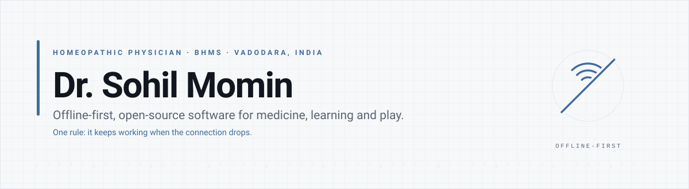
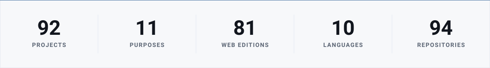
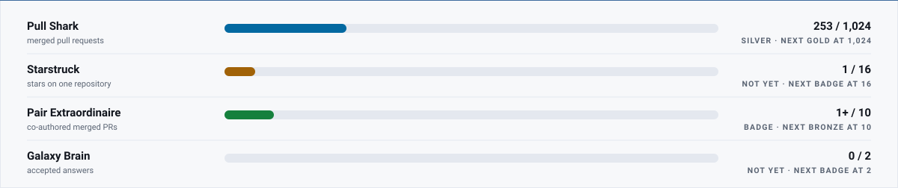

<picture>
  <source media="(prefers-color-scheme: dark)" srcset="assets/hero-dark.svg">
  <source media="(prefers-color-scheme: light)" srcset="assets/hero-light.svg">
  
</picture>

<h3 align="center">I write software that keeps working when the connection drops.</h3>

  I'm a practising homeopathic physician in Vadodara. Everything here is built on one premise:
  the app should be the whole app — no server to reach, no account to create, nothing phoned home.
  It turns out that covers most of what I want to make, from a clinician's repertory to a browser
  game that runs from a single file.

  
  
  
  
  
  

<picture>
  <source media="(prefers-color-scheme: dark)" srcset="assets/stats-dark.svg">
  <source media="(prefers-color-scheme: light)" srcset="assets/stats-light.svg">
  
</picture>

<!-- ACHIEVEMENTS:START -->

## Achievements

  &nbsp;
  &nbsp;
  &nbsp;
  &nbsp;

  <picture>
    <source media="(prefers-color-scheme: dark)" srcset="assets/progress-dark.svg">
    <source media="(prefers-color-scheme: light)" srcset="assets/progress-light.svg">
    
  </picture>

Counted from the API on every build. The two rows without a number are the two GitHub publishes no counter for.

<!-- ACHIEVEMENTS:END -->

## How every project here is built

Five commitments, and they are not aspirations — they are the reason each project exists in the
shape it does.

| The commitment | What it means in practice |
| :-- | :-- |
| **It works offline** | Open it with the network off and it still works. Not a cached shell — the whole thing. |
| **One file, where it can be** | A single HTML file with no build step, no bundler, no CDN, no dependency to rot. Drop it on a USB stick and it runs in ten years. |
| **No accounts** | Nothing to sign up for, nothing to remember, nothing to lose access to. |
| **No telemetry** | No analytics, no crash pings, no "anonymous usage statistics". The software does not know you used it. |
| **It stays yours** | Your cases, your notes, your files stay on your device. Where there is a server, it is one you run, in your own room. |

<!-- PROJECTS:START -->

## Start here

-  — 403 working tools in one portable Windows binary — file and folder work, encoding and hashing, images, PDFs, media, documents, network diagnostics, system maintenance, security checks and generators. No installer, no registry writes, no telemetry. &nbsp;·&nbsp; [source](https://github.com/drsamonline/All4ONE)
-  — A private, offline ambient sound mixer in a single HTML file — 25 synthesised layers, 36 presets and WAV/Opus export. &nbsp;·&nbsp; [source](https://github.com/drsamonline/ambient-sound-studio)
-  — A single-file clinical calculator — BMI, BMR (Mifflin–St Jeor), TDEE, macros, fluids and body composition, with Indian and WHO cut-offs in English, Hindi and Gujarati. &nbsp;·&nbsp; [source](https://github.com/drsamonline/bmi-bmr-tdee-macros-fluid-calculator)
-  — Boericke's Repertory as a free, offline single-file web app — a searchable clinical repertory and repertorisation tool, after Oscar E. Boericke, M.D. (1927). &nbsp;·&nbsp; [source](https://github.com/drsamonline/boericke-repertory)
-  — PIN-protect or one-time-view any HTML file with AES-256-GCM — a cross-platform CLI plus a browser GUI that runs on any OS. &nbsp;·&nbsp; [source](https://github.com/drsamonline/lockhtml)
-  — A retro auto-fire side-scrolling shooter in one self-contained HTML file — move, jump and duck; the gun fires itself. &nbsp;·&nbsp; [source](https://github.com/drsamonline/neon-runner)
-  — The classical homeopathic materia medica in plain language — 344 remedy portraits, with a free web edition and an offline Android companion. &nbsp;·&nbsp; [source](https://github.com/drsamonline/open-materia-medica)
-  — An offline single-file explorer for homeopathic remedy relationships, built from public-domain materia medicas (Boericke 1927, Clarke 1900, Hering 1879). &nbsp;·&nbsp; [source](https://github.com/drsamonline/remedy-relationship-explorer)
-  — A PowerShell and batch toolkit for documented, reversible Windows 10/11 debloat and performance tweaks. &nbsp;·&nbsp; [source](https://github.com/drsamonline/ULTIMATE-WINDOWS-OPTIMIZER)

## Everything, by purpose

###  Desktop, System & Developer Tools 
-  — A VS Code extension that brings web-chat AI models into the editor, so you can work without leaving the code.
-  — 403 working tools in one portable Windows binary — file and folder work, encoding and hashing, images, PDFs, media, documents, network diagnostics, system maintenance, security checks and generators. No installer, no registry writes, no telemetry.
-  — Compress, resize, convert and strip the GPS from photos on your own device — nothing uploaded, no account, works offline.
-  — A whole library served over your own Wi-Fi — browse and search offline content on the LAN, with no internet at any point.
-  — An optical file-transfer PWA — compress a file into a File DNA container, paint it as SpectraCode colour matrices and recover it with a camera.
-  — Offline file transfer over animated QR codes — no internet, no Bluetooth, no cables.
-  — A single tiny Rust binary that sits in the system tray, pops up on a keystroke and runs whatever you type — a sum, a path, an app or a search.
-  — One app, two optical transports — send a file with light over QR codes or a colour matrix, with no network at all.
-  — PIN-protect or one-time-view any HTML file with AES-256-GCM — a cross-platform CLI plus a browser GUI that runs on any OS.
-  — NOVA — a statically typed, compiled systems programming language whose compiler lowers to C, JavaScript, Rust and WebAssembly.
-  — Merge, split, rotate, reorder, watermark, number and compress PDFs entirely in the browser — no upload, no account, no server, works offline.
-  — Aetheris — an experimental C++ browser engine on a Ladybird/SerenityOS-derived codebase, built to learn how rendering works. Not production-ready.
-  — TinyToolBox — 591 tiny utilities bundled into one lightweight, offline-first browser extension for Chrome, Edge, Firefox and Safari.
-  — A PowerShell and batch toolkit for documented, reversible Windows 10/11 debloat and performance tweaks.

###  Games & Engines 
-  — Two free Aethelgard browser games — a visual novel (The Books) and a role-playing game (Chronicles of Fate).
-  — A dependency-free vanilla-JavaScript engine for deep single-player browser RPGs. Engine only — the games it powers live in aethelgard-games.
-  — A single-file browser rhythm game where every fight move is a dance move, driven by the beat grid of your own track.
-  — A single-file idle city-builder that grows from a Stone Age village into a Fusion Age world-city.
-  — A code-only open-world game engine for the browser — no assets, no dependencies; every texture, mesh and sound is generated at runtime.
-  — Two free open-world browser games on the Neon Engine — Dead Zone (zombie survival) and Neon Police.
-  — A retro auto-fire side-scrolling shooter in one self-contained HTML file — move, jump and duck; the gun fires itself.
-  — A procedural retro side-scrolling shooter for Godot 4.3 — zero binary assets, every sprite and sound generated at runtime.
-  — A complete retro third-person shooter in a single HTML file — a custom software 3D renderer and chiptune audio, no dependencies.
-  — Saga — a small, dependency-free visual-novel engine for the browser. Plain JavaScript, one stylesheet, no build step.
-  — SCRAP & GUN — a retro pixel-art arena-defence shooter with tactical construction, escalating waves, persistent upgrades, roguelite drafts, bosses and local co-op.

###  Health & Medicine 
-  — Per-patient clinical notes encrypted on the device with AES-256-GCM — offline, no account, no server.
-  — A single-file clinical calculator — BMI, BMR (Mifflin–St Jeor), TDEE, macros, fluids and body composition, with Indian and WHO cut-offs in English, Hindi and Gujarati.
-  — Boericke's Repertory as a free, offline single-file web app — a searchable clinical repertory and repertorisation tool, after Oscar E. Boericke, M.D. (1927).
-  — A triage-first home companion for a sick child — nine common childhood situations, a red-flag check and remedy orientation from the book Gentle Pediatrics.
-  — HHMS — a LAN-based hospital management system purpose-built for homeopathic hospitals and clinics, with a server-owned database and no cloud lock-in.
-  — Open-domain homoeopathic materia medica and repertory texts as app-ready JSON — 13 books (1840–1906), about 108,000 rubrics.
-  — Offline single-file explorer for Kent's Repertory (1897) — 74,667 rubrics, 735,500 graded remedy links, a case builder and grade-weighted repertorisation.
-  — Build your own materia medica and repertory — offline, private and yours to export.
-  — A study companion for Mnemosyne Materia Medica — 100 polycrest remedies as poetic pearls, keynotes and spaced-repetition drills.
-  — The classical homeopathic materia medica in plain language — 344 remedy portraits, with a free web edition and an offline Android companion.
-  — An offline single-file explorer for homeopathic remedy relationships, built from public-domain materia medicas (Boericke 1927, Clarke 1900, Hering 1879).
-  — A private, offline skin-case tracker built on the HHMS dashboard — history, habits, mapping and symptoms — with a 90-day pattern engine, from the book The Skin Is a Liar.
-  — A home homeopathic first-aid companion of 30 remedies with a symptom finder, dosing guidance and emergency signs, in English, Hindi and Gujarati.

###  Mind, Memory & Wellbeing 
-  — A private, offline resilience workspace in a single HTML file — read, reflect, journal, track and review.
-  — A companion PWA to Read. Live. Transform.: A Practical Reading of the Qur'an — read the verse, live the practice, keep the change.
-  — Strongbox — sealed notes opened once: seal a note with a passphrase and it opens a single time. Offline, no accounts.
-  — SmartNote Scheduler — AI-powered notes, reminders and scheduling: write in plain English and it files itself.
-  — A pocket PWA companion to The Symphony of the Present — the book's ideas as cards, its practices as a checklist, a breathing timer and a gratitude journal.
-  — Today Card — one card for the day: your date, one intention, one task and a streak. Offline, no accounts.
-  — An offline companion to The Unstoppable Mind — the book's key points, exercises, a 7-day challenge and flashcards.

###  Audio & Media 
-  — A private, offline ambient sound mixer in a single HTML file — 25 synthesised layers, 36 presets and WAV/Opus export.
-  — A pocket generative composer — an offline-first PWA that writes, synthesises, masters and exports music in the browser, with no server and no samples.

###  Business & Productivity 
-  — Clip Loom — clipboard programs you can read: strip tracking, tidy text, keep what matters. Weft-8 on the Loom.
-  — Order from your table over the room's own Wi-Fi — a LAN canteen board built with Forge.
-  — A shared whiteboard for the room: everyone on the same Wi-Fi draws on the same board, live.
-  — An AI-powered digital products and automation platform — practical planners, templates, AI resources and offline browser tools.
-  — A fast, serverless single-page GST billing and invoicing app for Indian businesses, with local IndexedDB storage.

###  Learning & Reference 
-  — A daily Indian almanac — tithi, nakshatra, yoga, karana, rahu-kaal and muhurat, computed offline.
-  — Rhyme, metre and fixed forms, fully offline — a poetry workshop that measures what you wrote, with 124,085 words bundled.
-  — Every number base, unit and timezone on one page, with the working shown — offline, no accounts.

###  Weft-8 & Retrocomputing 
-  — Jacquard — the loom you program: a Weft-8 8-bit assembler and VM with the device's sensors as memory-mapped peripherals.
-  — Weft Puzzles — small programming puzzles you solve in Weft-8 assembly, on the machine from Jacquard.
-  — Weft-8 Classroom — a teacher's pack and exercises for teaching how a computer works, offline, in one file.
-  — Weft-8 beside x86 and ARM — the same algorithm in three machines, so you can see which part is the computer.
-  — Weft-8 on real silicon — a C port of the Loom's 8-bit machine, an Arduino/ESP32 sketch and a parity harness.

###  Libraries & Kits 
-  — The art primitives Forge was missing: an indexed palette, a pixel canvas, draw ops, a delta undo stack, dithering, median-cut quantisation and sprite sheets.
-  — The shared astronomy core: sun and moon longitude (Meeus), ayanamsa, sunrise/sunset, and tithi, nakshatra, yoga and karana.
-  — Synthesis, theory, patterns and notation for offline apps: ADSR envelopes, oscillator voices, filters, scales, chords, a pattern sequencer and staff layout.
-  — The companion-app-from-a-book pattern: chapters, key points, practices, flashcards, search and reading progress.
-  — Clinical case tracking: sections, dated symptoms, follow-ups, a timeline and a summary.
-  — The shared compression core: gzip, deflate and deflate-raw via the platform's Compression Streams.
-  — The shared crypto core: AES-256-GCM, PBKDF2 passphrase keys, sealed envelopes and one-time view, on Web Crypto.
-  — Save text, JSON, CSV and binary to the user's device, and bundle files into a store-only ZIP.
-  — The shared transfer-frame core: a self-describing frame, a rateless collector and byte/checksum utilities.
-  — The shared game core: a fixed-timestep loop, input, scenes, save/load and maths.
-  — The shared LAN core: a local room with a real-time channel over Server-Sent Events and POST.
-  — The classic algorithms from scratch for offline features: tf-idf, Naive Bayes, k-NN, k-means, PCA, ID3, linear regression and Markov chains — no model, no API key, no network.
-  — The shared optical-transfer core: a systematic LT fountain code, self-describing frames and a pluggable codec.
-  — The homeopathic repertorisation core: rubric grading and grade-weighted remedy scoring.
-  — Ranked search over big corpora — an inverted index with prefix and fuzzy matching.
-  — Spaced repetition (SM-2) for flashcards — scheduling, lapses, due cards and stats.
-  — A reactive UI layer small enough for a single file: signals, computed, reactive effects, hyperscript, a keyed list, events, a hash router and form binding.
-  — The shared offline-first runtime for drsamonline apps: storage, i18n (EN/HI/GU), CSV, PWA, theme, SEO and accessibility.
-  — The Loom's Weft-8 as a reusable kit — an auditable, step-limited rule engine you can drop into another app.

###  CHCE Compression 
-  — The development workspace for the CHCE multi-repository project.
-  — CHCE — Holistic Compression Sources: the reference compressor sources the CHCE engines are built from.
-  — The CHCE orchestrator — chains prebuilt compression binaries into one pipeline.
-  — LEXORA — Layered EXact-text Repository and Adaptive compression architecture: canonicalise text, then compress it with guaranteed byte-exact recovery.
-  — The CHCE native engine — a single binary with the codecs embedded.

###  Meta & Infrastructure 
-  — A shared build kit that compiles a static web app into a single-file portable Windows EXE and an Android WebView APK.
-  — Forge tooling, not a product app — an offline pocket console for the Forge system.
-  — The change log for the drsamonline fleet: what was measured, what was fixed, and the evidence.
-  — Snapshot a repository before a merge replaces it — a reusable GitHub workflow plus a zero-dependency script, compressed, timestamped and rotated to keep the newest 100.
-  — Every workflow in every repo: what runs, when, what calls what, and what is connected to nothing.
-  — Live status of the drsamonline system — the repo fleet, build health, downloads and the store.
-  — A small reusable kit for a theme-aware, self-updating GitHub profile — hero banner, metrics card and README generator.
-  — Reusable, machine-consumable skills extracted from every drsamonline project — a categorised, self-updating catalogue.

<!-- PROJECTS:END -->

## The books, and the apps that come with them

Seven of these projects are companions to books I have written — the book does the reading, the app
does the practice: a checklist, a symptom finder, a case log, a set of flashcards.

| The book | The companion | What it does |
| :-- | :-- | :-- |
| *Gentle Pediatrics* | [gentle-pediatrics-companion](https://drsamonline.github.io/gentle-pediatrics-companion/) | Triage-first help for a sick child: nine common situations, a red-flag check, remedy orientation. |
| *The Skin Is a Liar* | [skin-case-tracker](https://drsamonline.github.io/skin-case-tracker/) | A private skin-case log with a 90-day pattern engine. |
| *The Whispering Body* | [whispering-body-first-aid](https://drsamonline.github.io/whispering-body-first-aid/) | A home first-aid box of 30 remedies, with a symptom finder and emergency signs. |
| *The Symphony of the Present* | [the-symphony-companion](https://drsamonline.github.io/the-symphony-companion/) | The ideas as cards, the practices as a checklist, a breathing timer, a gratitude journal. |
| *The Unstoppable Mind* | [unstoppable-mind-companion](https://drsamonline.github.io/unstoppable-mind-companion/) | Key points, exercises, a seven-day challenge, flashcards. |
| *Read. Live. Transform.* | [read-live-transform-app](https://drsamonline.github.io/read-live-transform-app/) | A practical reading of the Qur'an: read the verse, live the practice, keep the change. |
| *Mnemosyne Materia Medica* | [mnemosyne-companion](https://drsamonline.github.io/mnemosyne-companion/) | A hundred polycrest remedies as poetic pearls, keynotes and spaced repetition. |

## Signals

  <picture>
    <source media="(prefers-color-scheme: dark)" srcset="assets/metrics-dark.svg">
    <source media="(prefers-color-scheme: light)" srcset="assets/metrics-light.svg">
    
  </picture>

  Contribution activity, rendered from the GitHub API by a scheduled workflow. The strip at the
  top of this page is counted the same way, on every run.

## Colophon

**How this page is made.** Two GitHub Actions workflows and one file. `catalogue.json` holds the
description and the purpose of every repository; this profile and the [project hub](https://drsamonline.github.io/)
are both generated from it, daily. A new repository appears in both without anyone editing this
page — and if a description is edited on GitHub, this page follows it on the next run. The numbers
in the strip are read from the API at build time, so they cannot drift.

**Licences.** Most repositories are PolyForm Noncommercial 1.0.0; a few are MIT, and some carry a
bespoke "free for personal use" term. The `LICENSE` file in the repository you are reading is the
one that counts — not a badge on this page.

**Elsewhere.** Poet and social worker the rest of the time. Email is the reliable way to reach me:
[sohilmomin2000@gmail.com](mailto:sohilmomin2000@gmail.com).

  Built in Vadodara, Gujarat. No trackers on this page, either.

